# Doctor Tracker

Doctor Tracker is an admin portal for clinics that need to see, at a glance, who their doctors are and how the patients in their care are doing. Signed-in staff can search, filter and sort hundreds of doctors and tens of thousands of patients in a few keystrokes, add and update records, and read a dashboard that answers the questions an operations lead asks: how are our patients doing, is the load spread evenly, where are the critical cases, and when do people arrive. This repository is the Next.js frontend. It talks to a separate Express and MongoDB API, in the `doctor-tracker-backend` repository, through a client generated from that API's OpenAPI document.

| Area | What is there |
| --- | --- |
| Sign-in and access | Email and password against the API's sessions. Every page behind sign-in is protected. Admins can change records; viewers can only read, and the add, edit and delete controls are not rendered for them. |
| Doctors | Add, edit and delete. Search by name, hospital, phone or email. Filter by specialization, hospital and date added. Sort by name, specialization, hospital, patient count or date added. Each row shows the doctor's patient count beside its split by condition. |
| A doctor's page | Contact details, three charts about that doctor's patients, and their patient list with its own search, filters and sorting. Add a patient under the doctor, edit one, or delete one from the list. |
| Patients | Every patient, with search by name, diagnosis or phone, filters for condition, gender, doctor and registration date, sorting (including by severity), paging, edit and delete. |
| Dashboard | Totals, patients per doctor, the condition breakdown, how evenly the load is spread, where the critical patients are, registrations over time and by weekday and hour, age and gender. |
| Everywhere | A command palette on `⌘K` / `Ctrl K`, live doctor and patient counts in the sidebar, light and dark themes, and layouts for phone, tablet and desktop. |

## Stack

- **Framework:** Next.js 16 (App Router, Cache Components, React Compiler) and React 19
- **UI:** Tailwind CSS 4 and shadcn/ui on Base UI primitives
- **Server data:** TanStack Query 5, with a typed client generated by `@hey-api/openapi-ts`
- **Tables:** TanStack Table 9
- **URL state:** nuqs
- **Forms:** React Hook Form and Zod 4
- **Client state:** Zustand, for interface preferences only
- **Charts:** Recharts for the two charts that need axes, plain HTML and CSS for the rest
- **Auth:** better-auth client, against sessions issued by the API

## Setup guide

You need Node.js 22 or later and pnpm. Start the API first; its README covers that in five commands and seeds the demo data.

```bash
# 1. Install dependencies
pnpm install

# 2. Point the app at the API (http://localhost:4000 by default)
cp .env.example .env.local

# 3. Start the app
pnpm dev
```

Open `http://localhost:3000` and sign in. The sign-in page has buttons that fill in either demo account:

| Role | Email | Password | Can do |
| --- | --- | --- | --- |
| Admin | `admin@doctortracker.dev` | `Admin@12345` | Everything |
| Viewer | `viewer@doctortracker.dev` | `Viewer@12345` | Read only; add, edit and delete controls are hidden |

### Environment variables

| Variable | Purpose |
| --- | --- |
| `API_URL` | Base URL of the Doctor Tracker API. `/api/*` is proxied to it, and server components call it directly. |

### Scripts

| Command | Purpose |
| --- | --- |
| `pnpm dev` | Run the app with reload |
| `pnpm build` / `pnpm start` | Build and serve the production app |
| `pnpm typecheck` / `pnpm lint` | Static checks |
| `pnpm api:pull` | Download the API's current OpenAPI document into `openapi.json` |
| `pnpm api:generate` | Regenerate the typed client in `src/lib/api/generated` |

When an endpoint changes in the API, run `pnpm api:pull` then `pnpm api:generate`. Any call site that no longer matches the contract fails `pnpm typecheck`.

## System architecture

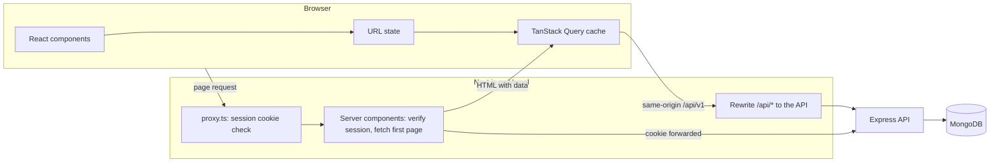

How a page loads:

1. **Guard.** `proxy.ts` checks for a session cookie and redirects signed-out visitors to `/login` before anything renders.
2. **Static shell.** The sidebar, the page title and its artwork, and the loading skeletons are prerendered at build time, so they appear immediately.
3. **Server fetch.** Inside a Suspense boundary, a server component verifies the session against the API, reads the filters from the URL, and fetches the first page of data with the visitor's cookie.
4. **Hydration.** That data is sent in the HTML and placed in the TanStack Query cache, so the table is already rendered when JavaScript loads and the browser does not fetch it again.
5. **Interaction.** From then on, search, filters, sorting and paging change the URL, and TanStack Query fetches through `/api/*`, which Next.js rewrites to the API.

The browser never calls the API's own domain. Because every request goes through the Next.js origin, the session cookie is first-party and httpOnly, there is no CORS setup, and no token is ever readable from JavaScript.

Access is enforced in three places: the proxy (is there a cookie?), the server components (is the session valid, and is this user an admin?), and the API itself on every request. The first two are for experience; only the API is the security boundary.

```
src/
  app/
    (auth)/login/          Sign-in page
    (app)/                 Signed-in area: sidebar, page panel, command palette
      dashboard/           Analytics
      doctors/             List, and [id] for a doctor's profile and patients
      patients/            List
  proxy.ts                 Redirects signed-out visitors
  features/
    auth/ doctors/ patients/ dashboard/
                           Each holds its queries, URL params, form schema and components
    search/                Command palette: frame, lazily loaded body, search hook
  components/
    ui/                    shadcn/ui components
    data-table/            Shared table: sorting, pinning, row menus, pagination, filters
    charts/                Shared tooltip, keyboard navigation and table view for charts
    app-shell/             Sidebar, mobile top bar, user menu
    brand.tsx              Logo and two-colour wordmark
    page-motif.tsx         The artwork behind each page title
  lib/
    api/                   Generated client, runtime config, ApiError
    session.ts             Server-only: current user and cookie forwarding
    query-client.ts        Query defaults, retry rules, sign-out on 401
    list-params.ts         URL state shared by every list, including sort keys
  stores/preferences.ts    Theme, table row spacing and pinned columns
```

## Technical decisions

### 1. Three homes for state instead of one global store

The usual answer to "where does state live" is a single store such as Redux. In this app that would mean copying API data into the store, writing reducers to keep it in sync, and separately keeping the URL in step with the filters. Instead, each kind of state lives where it is naturally owned:

| State | Lives in | Why |
| --- | --- | --- |
| Doctors, patients, analytics | TanStack Query | It is the server's data. Query handles caching, deduplication, retries, background refresh and invalidation, which a hand-written store would have to reimplement. |
| Search, filters, sort, page, dashboard period | The URL, through nuqs | A filtered, sorted list can be bookmarked, shared and reloaded, and the back button works. The server can also read it, which is what makes the first page server-rendered. |
| Theme, table row spacing, pinned columns | Zustand, persisted to `localStorage` | The only true global client state: preferences about how the interface looks, which belong to the person and not to a link. |

Zustand over Redux for that last row because the store is under fifty lines with no reducers or provider, and a component subscribes to just the field it uses. Redux's strengths, such as middleware, time-travel debugging and strict update patterns, pay off when a large amount of client-owned state changes in complex ways. Here almost nothing is client-owned.

What this buys in practice:

- **No duplicate source of truth.** A mutation invalidates a query key (`doctors`, `patients`, `analytics`) and every screen showing that data refetches. There is no store to update by hand.
- **Fewer re-renders.** Typing in search updates the input at once, while the list waits for a 300 ms pause and keeps the previous page on screen, dimmed, until the new one arrives. Column definitions live at module scope so the table model is not rebuilt each render, and the React Compiler memoizes the rest.
- **Fast paging.** The next page is fetched in the background as soon as the current one is shown.
- **Optimistic deletes.** Deleting a patient removes the row from every cached page immediately, then confirms with the server. If the request fails, the saved pages are restored and a message says why.

The cost is that there is no single place to inspect all state, and URL state needs validating because people can edit it. Each parameter is parsed against what the API accepts (allowed values, a real id, a length limit), so a hand-edited URL falls back to defaults rather than sending a bad request.

### 2. A prerendered shell, with the first page of data fetched on the server

An authenticated dashboard is commonly built as a client-only app: ship an empty page, then fetch everything from the browser. That shows a spinner, costs a round trip before any data appears, and ignores what the server already knows. Rendering the whole page on the server per request has the opposite problem: nothing appears until the slowest query finishes.

This app uses Next.js 16's Cache Components to split each page in two:

- **The shell is static.** Sidebar, page title, artwork and loading skeletons contain nothing user-specific, so they are prerendered at build time and served instantly.
- **The data streams in.** Each page wraps its data in a Suspense boundary. Inside it, a server component reads the URL and the session, fetches the first page from the API with the visitor's cookie, and passes it to TanStack Query through a hydration boundary. The finished table arrives in the same response as real HTML.

After that the browser owns the data, so filtering and paging are client-side fetches with no full page render.

Three details made this work correctly:

- **Session reads are kept out of the layout.** An early version looked up the user at the top of the signed-in layout. That made the entire shell wait for the session, left the prerendered page empty, and produced a server warning on every request. The user menu and the admin-only buttons now each sit in their own small boundary, and the shell is static again. The production build lists every signed-in route as partially prerendered.
- **Time-zone-dependent requests stay in the browser.** A date filter means "the visitor's days", and the dashboard's daily chart and arrival heatmap group by the visitor's time zone, which the server cannot know. Those requests are skipped on the server and fetched after load, rather than being fetched twice with different parameters. On the dashboard they also wait until their section is within a screen of the viewport, so on a laptop screen the dashboard opens without a single API call from the browser, and the last two arrive as someone scrolls towards them.
- **Nothing shifts when the data lands.** The page panel reserves its scrollbar gutter, and skeletons are sized to the finished content, so a list that grows past the fold does not push the layout sideways.

The trade-off is more moving parts than a client-only app: query keys must match exactly between server and browser, so both build their request through the same function (`toDoctorQuery`, `toPatientQuery`).

### Other decisions

**Tables**

- **Sorting is the API's job.** With 30,000 patients the browser only ever holds one page, so it cannot sort. Each sortable column maps to a sort key the API accepts, and each key is the order of a MongoDB index (the backend README lists them). Condition sorts by severity, not alphabetically, so "critical first" is one click.
- **Columns can be pinned.** Any column can be pinned to the left or right from its header menu and stays in place while the rest scroll under it. The name and the actions are pinned by default, and the choice is remembered per table. An edge shadow appears only while something is scrolled underneath.
- **The row's edge is the patient's condition.** A coloured strip runs down the leading edge of every patient row and stays put during sideways scroll, so a column of red is visible before any text is read. The Condition column still names it in words.
- **One menu, three ways in.** A row's actions are defined once and rendered by both the three-dot button and a right-click menu, so the two cannot drift apart. Links, form fields and selected text keep the browser's own menu. `Shift F10` and long-press open it as well.
- **Only the rows scroll.** On the Doctors and Patients pages the card is held to the height of the window, so the search bar, the column headers and the pagination stay where they are and the rows scroll between them. One element scrolls in both directions, which is what lets the headers stick to the top while pinned columns stick to the side. The scrollbar's gutter is reserved, so a scrollbar appearing cannot push a column out of view.
- **Filters live in a sheet.** The toolbar is one row: search, a Filters button and row spacing. The sheet slides in from the right on desktop and up from the bottom on a phone. Filters apply as they are changed, the list stays visible behind the sheet, and its main button says what you will get ("Show 42 doctors"). Each active filter is also a chip above the table that removes it in one click.
- **Cards below 768 px.** A seven-column table on a phone is a scrolling exercise, so each row becomes a card there, and sorting moves into the filter sheet.

**Command palette**

- **It costs nothing until it is used.** The shortcut, the dialog frame and the sidebar trigger are in every page's bundle. The body, with the search and the commands, is a separate chunk that downloads on first open, or as soon as the pointer reaches the Search button. Anything typed before it arrives is kept.
- **A keystroke is two index scans.** Doctors and patients are searched in parallel through the same indexed prefix search the lists use, five results each, after a 200 ms pause. A newer search cancels the one in flight.
- **Narrowing a search often needs no request.** If an earlier, broader search returned every match it had, typing more letters filters those rows in the browser. The palette splits words exactly as the API does, so the answer is the same one the server would give.
- **It knows where it is and who is asking.** On a doctor's page it offers "Add a patient to" that doctor. Viewers are not offered any action that creates a record.

**Charts**

- **Each one answers a question, and says the answer.** The description under a chart's title is a sentence computed from the data, for example "Half of the 300 doctors have 63 patients or fewer, while the busiest tenth have 270 or more each." The chart is the evidence, not a puzzle.
- **The form follows the question.** A distribution is a histogram with the median and 90th percentile marked. Parts of a whole are one segmented bar. A ranking is a sorted bar list. Two dimensions of time, weekday and hour, are a heatmap. There are no pie charts, because comparing angles is harder than comparing lengths.
- **Colour means condition, and nothing else.** Green, violet, amber and red are reserved for the four patient conditions wherever they appear: badges, row edges, bars, form controls. Every other mark is one blue. The four colours were checked for separation under the common forms of colour blindness and for contrast in both themes, and no chart relies on colour alone.
- **Comparable by design.** In the condition mix, critical is always the last segment, so the red ends line up down the rows, and a hairline on each bar marks the clinic-wide critical share to compare against.
- **Usable without a pointer.** Marks have keyboard focus and tooltips, the heatmap and histograms move with the arrow keys from a single tab stop, and the condition mix and heatmap can each be opened as a plain table.
- **Local conventions.** The heatmap's week starts on Sunday, as the working week does in Bangladesh, and hours are in the visitor's time zone.

**Look and layout**

- **The theme comes from the logo.** Its blue and mint are the two brand colours, each with a light-theme and a dark-theme shade chosen for contrast, and the wordmark is set in the same two colours.
- **Blue acts, mint marks.** Each brand colour has one job. Blue is for actions, focus and data: buttons, links, focus rings and chart marks. Mint is for state: what is selected (a toggle, the current page, the active sort), what is highlighted (the item under the pointer in a menu or the command palette), filter chips and tags, and a rise in a trend. Mint is kept out of the charts on purpose: darkened enough to read on white, it lands on the green that means "stable".
- **An inset shell.** The sidebar sits on a tinted plane that runs from the logo's blue at the top to its mint at the bottom, and the page is one rounded panel beside it, with no top bar on desktop. Search, theme and the collapse control live in the sidebar.
- **An icon for every specialization.** All fifteen come from one family, Health Icons (CC0), in its outline set drawn for 24 px, so they match each other and sit beside the interface's own icons. Only the glyphs in use are in the code, not the whole library, and a specialization the set does not know falls back to a plain medical cross.
- **Each page has its own header artwork**, drawn in SVG from the logo's cross: a heartbeat trace on the dashboard, a field of crosses for doctors, a ward board for patients. It is part of the prerendered shell and downloads nothing.
- **On phones** the sidebar becomes a drawer, and a top bar holds the menu button, the logo and the page's main action, so "Add patient" is always one tap away.

**Smaller choices**

- **Generated API client.** Request and response types come from the API's OpenAPI document, so the two repositories cannot drift apart silently. Form schemas are hand-written for friendly messages but checked against the generated types with `satisfies`.
- **API errors land on fields.** A validation error from the API is shown under the input it refers to, and a duplicate email is reported on the email field.
- **Missing records and failed loads have their own screens**, each with a way back, so a stale link never ends in a blank page.

## Visual evidence

### Desktop

| Dashboard | Workload |
| --- | --- |
|  | 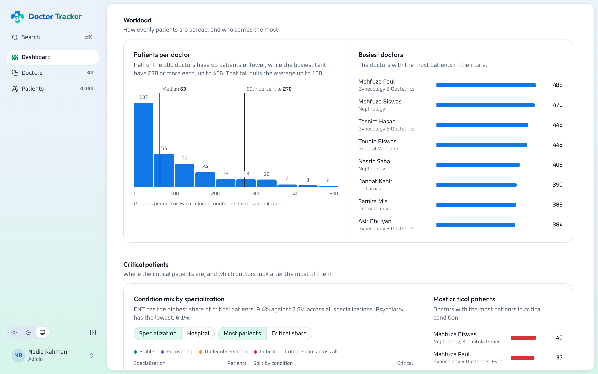 |

| Arrivals | Critical patients, dark theme |
| --- | --- |
| 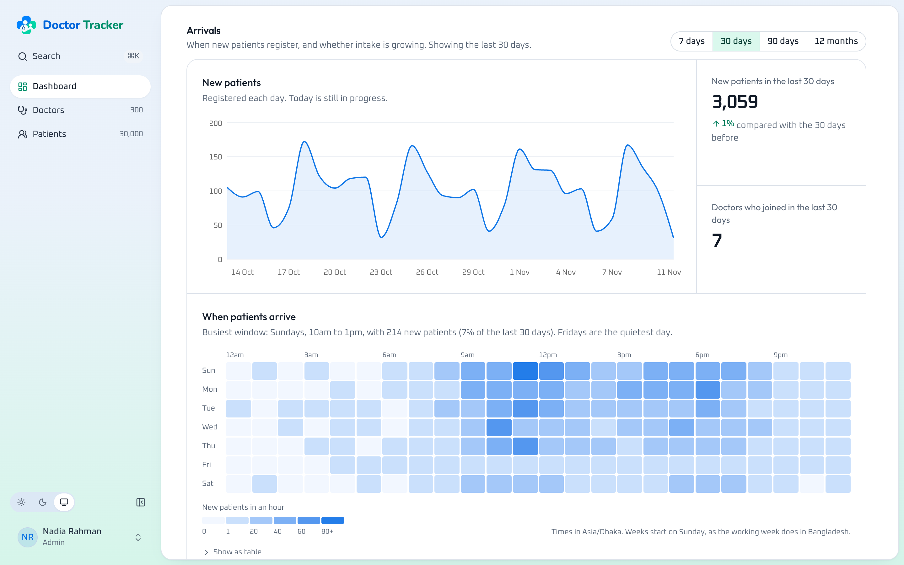 |  |

| Doctors, sorted by patients | Doctor profile |
| --- | --- |
|  |  |

| Patients, critical first | Filter sheet |
| --- | --- |
|  | 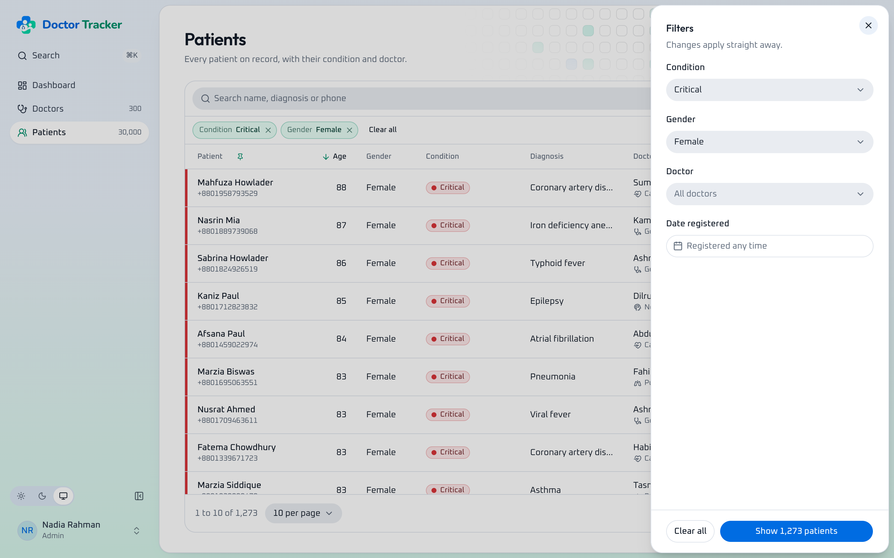 |

| Sorting and pinning | Right-click menu |
| --- | --- |
| 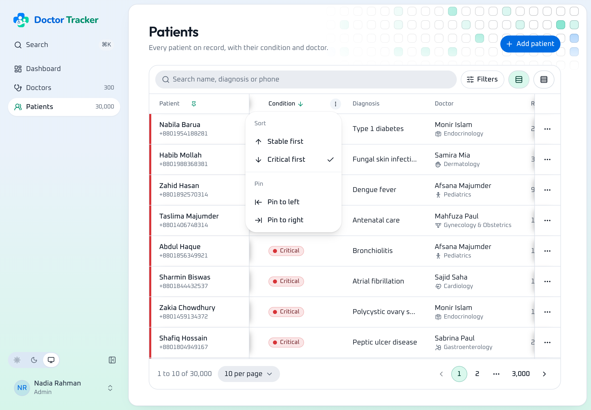 | 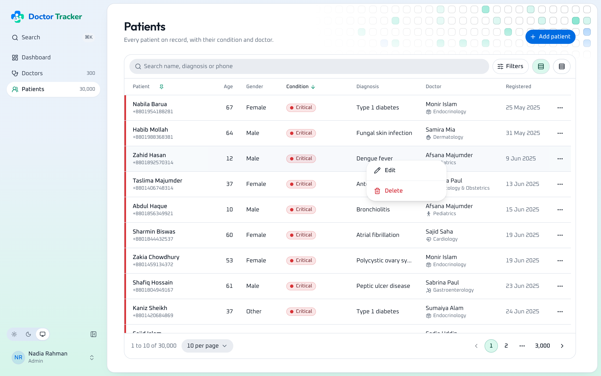 |

| Command palette | Patients, dark theme |
| --- | --- |
| 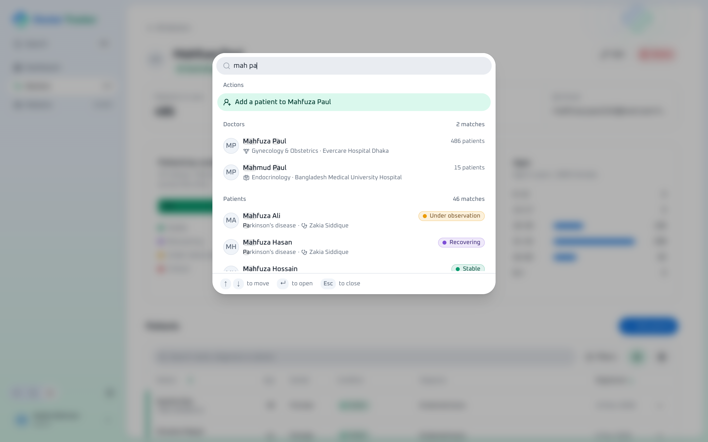 | 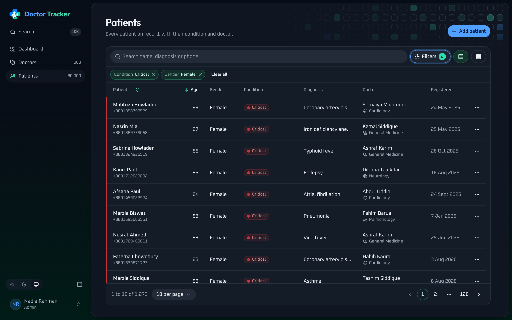 |

| Sign in |
| --- |
|  |

### Mobile

| Dashboard | Condition mix | Arrival heatmap | Navigation |
| --- | --- | --- | --- |
|  | 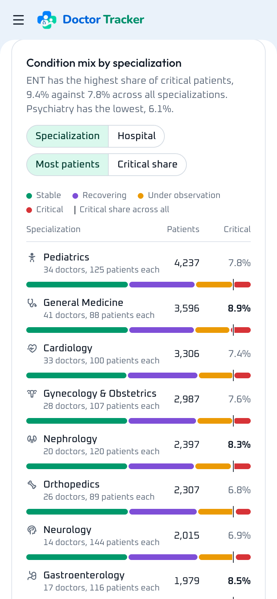 | 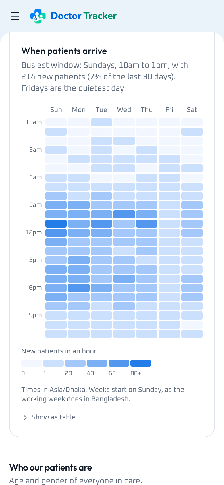 |  |

| Doctors | Patients | Filters | Doctor profile |
| --- | --- | --- | --- |
|  |  | 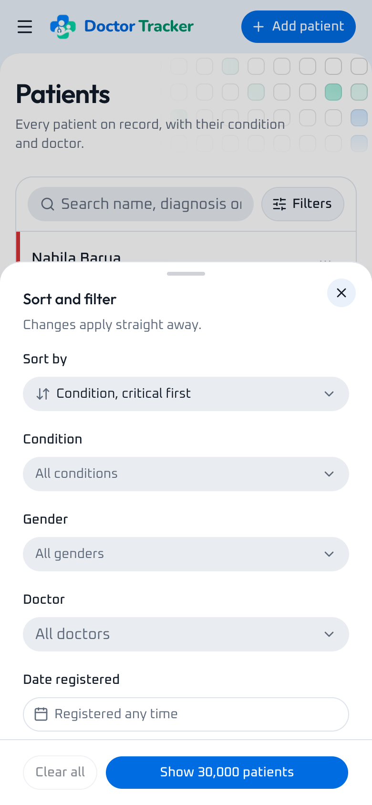 | 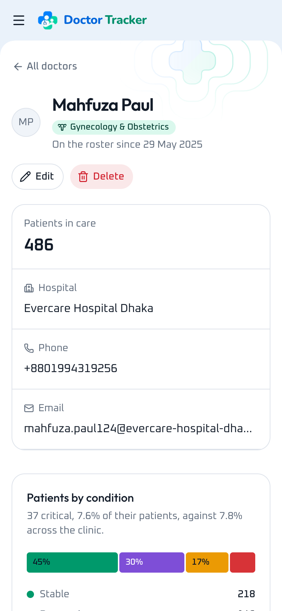 |
