# Doctor Tracker

Doctor Tracker is an admin portal for clinics that need to see, at a glance, who their doctors are and how the patients in their care are doing. Signed-in staff can search and filter hundreds of doctors and tens of thousands of patients in a few keystrokes, add and update records, and read a dashboard that puts patient condition first: one bar shows how many patients are stable, recovering, under observation or critical. This repository is the Next.js frontend. It talks to a separate Express and MongoDB API, in the `doctor-tracker-backend` repository, through a client generated from that API's OpenAPI document.

## Stack

- **Framework:** Next.js 16 (App Router, Cache Components, React Compiler) and React 19
- **UI:** Tailwind CSS 4 and shadcn/ui on Base UI primitives
- **Server data:** TanStack Query 5, with a typed client generated by `@hey-api/openapi-ts`
- **Tables:** TanStack Table 9
- **URL state:** nuqs
- **Forms:** React Hook Form and Zod 4
- **Client state:** Zustand, for interface preferences only
- **Charts:** Recharts, plus plain CSS bars
- **Auth:** better-auth client, against sessions issued by the API

## Setup guide

You need Node.js 22 or later and pnpm. Start the API first; its README covers that in five commands and seeds the demo data.

```bash
# 1. Install dependencies
pnpm install

# 2. Point the app at the API (http://localhost:4000 by default)
cp .env.example .env.local

# 3. Start the app
pnpm dev
```

Open `http://localhost:3000` and sign in. The sign-in page has buttons that fill in either demo account:

| Role | Email | Password | Can do |
| --- | --- | --- | --- |
| Admin | `admin@doctortracker.dev` | `Admin@12345` | Everything |
| Viewer | `viewer@doctortracker.dev` | `Viewer@12345` | Read only; add, edit and delete controls are hidden |

### Environment variables

| Variable | Purpose |
| --- | --- |
| `API_URL` | Base URL of the Doctor Tracker API. `/api/*` is proxied to it, and server components call it directly. |

### Scripts

| Command | Purpose |
| --- | --- |
| `pnpm dev` | Run the app with reload |
| `pnpm build` / `pnpm start` | Build and serve the production app |
| `pnpm typecheck` / `pnpm lint` | Static checks |
| `pnpm api:pull` | Download the API's current OpenAPI document into `openapi.json` |
| `pnpm api:generate` | Regenerate the typed client in `src/lib/api/generated` |

When an endpoint changes in the API, run `pnpm api:pull` then `pnpm api:generate`. Any call site that no longer matches the contract fails `pnpm typecheck`.

## System architecture

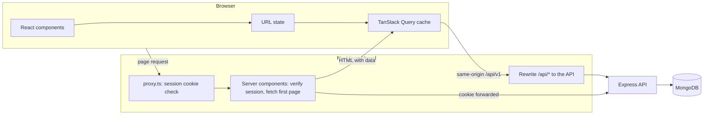

How a page loads:

1. **Guard.** `proxy.ts` checks for a session cookie and redirects signed-out visitors to `/login` before anything renders.
2. **Static shell.** The sidebar, header and page title are prerendered at build time, so they appear immediately.
3. **Server fetch.** Inside a Suspense boundary, a server component verifies the session against the API, reads the filters from the URL, and fetches the first page of data with the visitor's cookie.
4. **Hydration.** That data is sent in the HTML and placed in the TanStack Query cache, so the table is already rendered when JavaScript loads and the browser does not fetch it again.
5. **Interaction.** From then on, search, filters and paging change the URL, and TanStack Query fetches through `/api/*`, which Next.js rewrites to the API.

The browser never calls the API's own domain. Because every request goes through the Next.js origin, the session cookie is first-party and httpOnly, there is no CORS setup, and no token is ever readable from JavaScript.

Access is enforced in three places: the proxy (is there a cookie?), the server components (is the session valid, and is this user an admin?), and the API itself on every request. The first two are for experience; only the API is the security boundary.

```
src/
  app/
    (auth)/login/          Sign-in page
    (app)/                 Signed-in area: layout with sidebar and header
      dashboard/           Analytics
      doctors/             List, and [id] for a doctor's profile and patients
      patients/            List
  proxy.ts                 Redirects signed-out visitors
  features/
    auth/ doctors/ patients/ dashboard/
                           Each holds its queries, URL params, form schema and components
  components/
    ui/                    shadcn/ui components
    data-table/            Shared table, pagination, search, filters, date range
    app-shell/             Sidebar, header, user menu
  lib/
    api/                   Generated client, runtime config, ApiError
    session.ts             Server-only: current user and cookie forwarding
    query-client.ts        Query defaults, retry rules, sign-out on 401
    list-params.ts         URL state shared by every list
  stores/preferences.ts    Theme and table row spacing
```

## Technical decisions

### 1. Three homes for state instead of one global store

The usual answer to "where does state live" is a single store such as Redux. In this app that would mean copying API data into the store, writing reducers to keep it in sync, and separately keeping the URL in step with the filters. Instead, each kind of state lives where it is naturally owned:

| State | Lives in | Why |
| --- | --- | --- |
| Doctors, patients, analytics | TanStack Query | It is the server's data. Query handles caching, deduplication, retries, background refresh and invalidation, which a hand-written store would have to reimplement. |
| Search, filters, sort, page | The URL, through nuqs | A filtered list can be bookmarked, shared and reloaded, and the back button works. The server can also read it, which is what makes the first page server-rendered. |
| Theme and table row spacing | Zustand, persisted to `localStorage` | The only true global client state: two preferences that many components read. |

Zustand over Redux for that last row because the store is under forty lines with no reducers or provider, and a component subscribes to just the field it uses. Redux's strengths, such as middleware, time-travel debugging and strict update patterns, pay off when a large amount of client-owned state changes in complex ways. Here almost nothing is client-owned.

What this buys in practice:

- **No duplicate source of truth.** A mutation invalidates a query key (`doctors`, `patients`, `analytics`) and every screen showing that data refetches. There is no store to update by hand.
- **Fewer re-renders.** Typing in search updates the input at once, while the list waits for a 300 ms pause and keeps the previous page on screen, dimmed, until the new one arrives. Column definitions live at module scope so the table model is not rebuilt each render, and the React Compiler memoizes the rest.
- **Fast paging.** The next page is fetched in the background as soon as the current one is shown.
- **Optimistic deletes.** Deleting a patient removes the row from every cached page immediately, then confirms with the server. If the request fails, the saved pages are restored and a message says why.

The cost is that there is no single place to inspect all state, and URL state needs validating because people can edit it. Each parameter is parsed against what the API accepts (allowed values, a real id, a length limit), so a hand-edited URL falls back to defaults rather than sending a bad request.

### 2. A prerendered shell, with the first page of data fetched on the server

An authenticated dashboard is commonly built as a client-only app: ship an empty page, then fetch everything from the browser. That shows a spinner, costs a round trip before any data appears, and ignores what the server already knows. Rendering the whole page on the server per request has the opposite problem: nothing appears until the slowest query finishes.

This app uses Next.js 16's Cache Components to split each page in two:

- **The shell is static.** Sidebar, header, page title and loading skeletons contain nothing user-specific, so they are prerendered at build time and served instantly.
- **The data streams in.** Each page wraps its data in a Suspense boundary. Inside it, a server component reads the URL and the session, fetches the first page from the API with the visitor's cookie, and passes it to TanStack Query through a hydration boundary. The finished table arrives in the same response as real HTML.

After that the browser owns the data, so filtering and paging are client-side fetches with no full page render.

Two details made this work correctly:

- **Session reads are kept out of the layout.** An early version looked up the user at the top of the signed-in layout. That made the entire shell wait for the session, left the prerendered page empty, and produced a server warning on every request. The user menu and the admin-only buttons now each sit in their own small boundary, and the shell is static again. The production build lists every signed-in route as partially prerendered.
- **Time-zone-dependent requests stay in the browser.** A date filter means "the visitor's days", and the dashboard's daily chart groups by the visitor's time zone, which the server cannot know. Those two requests are skipped on the server and fetched after load, rather than being fetched twice with different parameters.

The trade-off is more moving parts than a client-only app: query keys must match exactly between server and browser, so both build their request through the same function (`toDoctorQuery`, `toPatientQuery`).

### Smaller choices

- **Generated API client.** Request and response types come from the API's OpenAPI document, so the two repositories cannot drift apart silently. Form schemas are hand-written for friendly messages but checked against the generated types with `satisfies`.
- **Colour means condition.** The interface is deliberately neutral, and colour is reserved for patient condition wherever it appears: badges, the dashboard bar, form controls. The four colours were checked for colour-blind separation, and every use pairs the colour with a text label. All other chart marks share one neutral ink.
- **API errors land on fields.** A validation error from the API is shown under the input it refers to, and a duplicate email is reported on the email field.
- **Responsive tables.** Tables become stacked cards on small screens instead of scrolling sideways, and the sidebar becomes a drawer.

## Visual evidence

### Desktop

| Dashboard | Dashboard, charts |
| --- | --- |
| 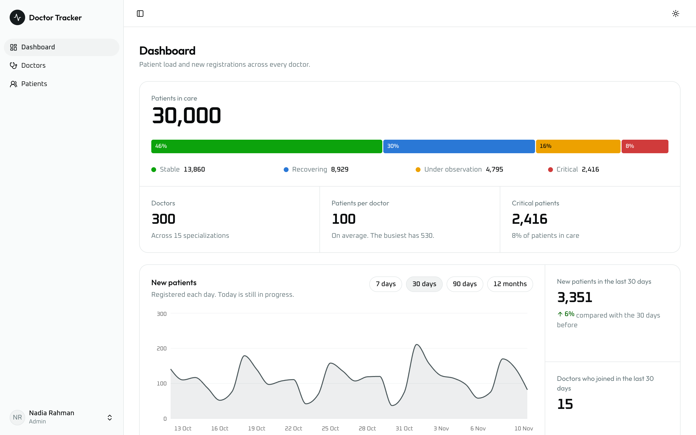 | 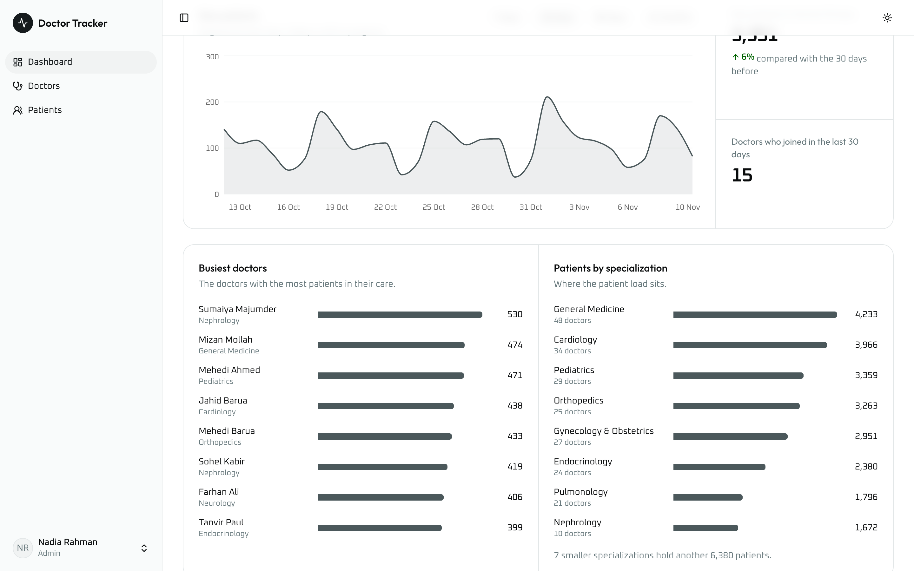 |

| Doctors | Doctor profile |
| --- | --- |
| 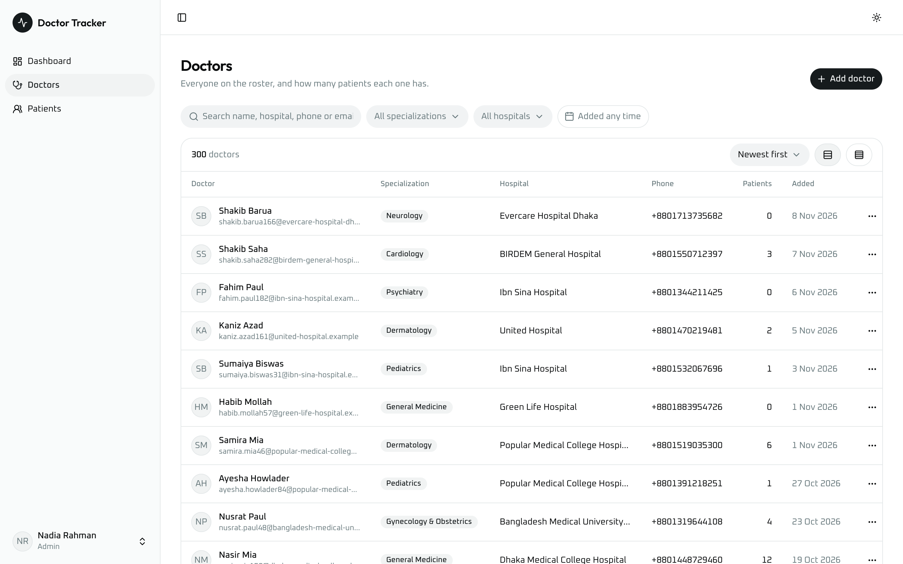 | 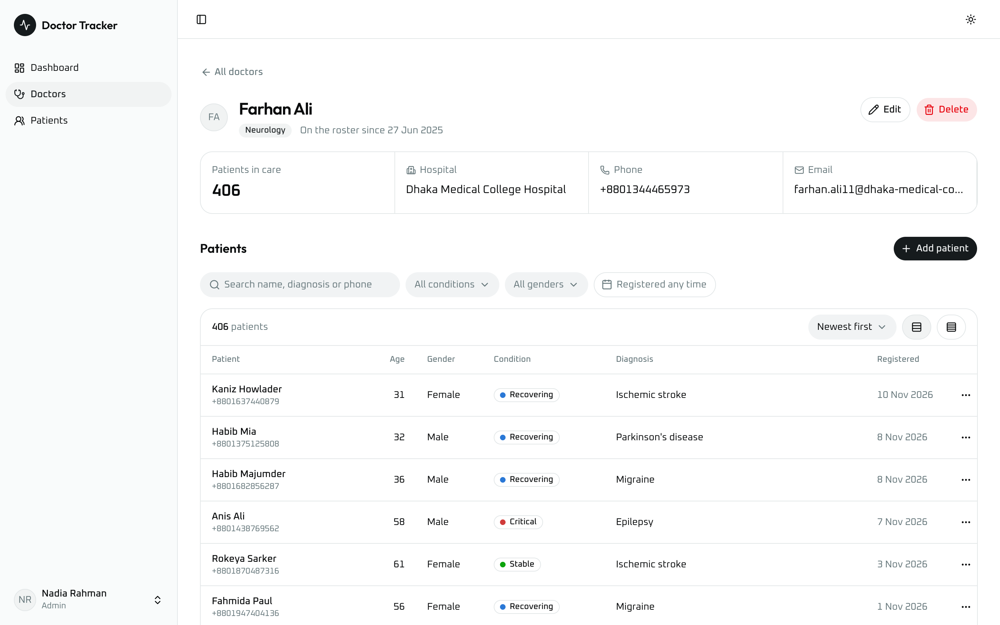 |

| Patients, filtered to critical | Dark theme |
| --- | --- |
| 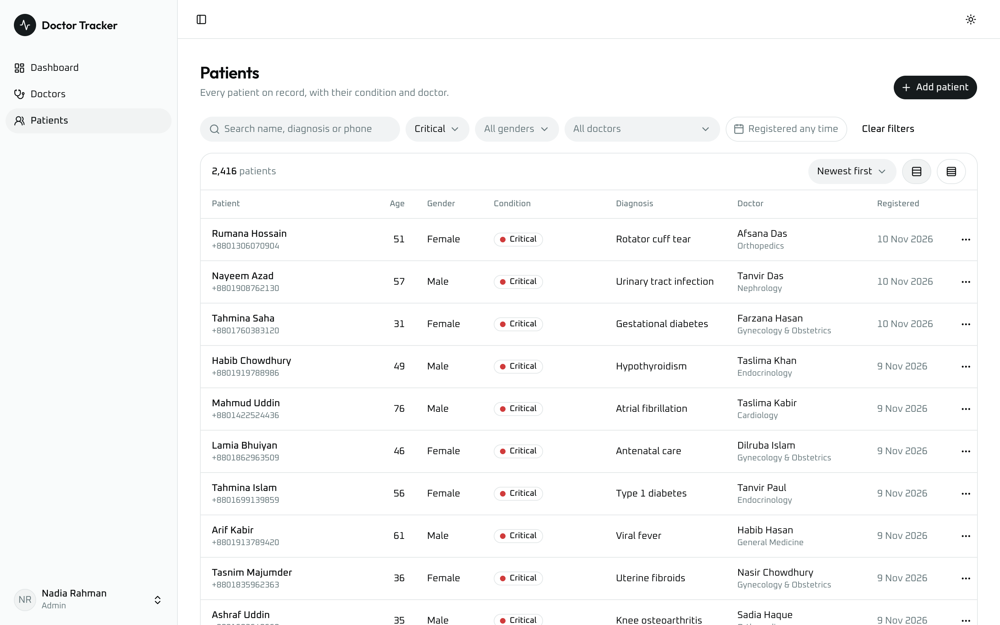 | 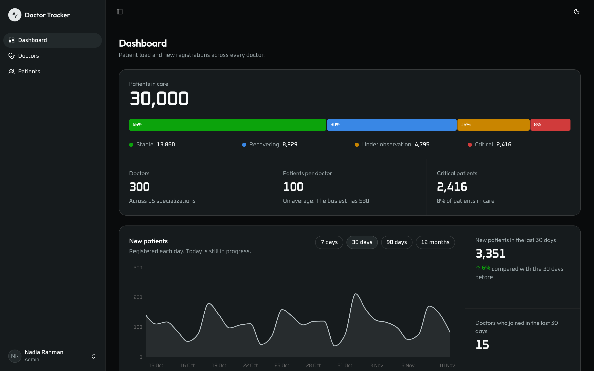 |

| Sign in |
| --- |
| 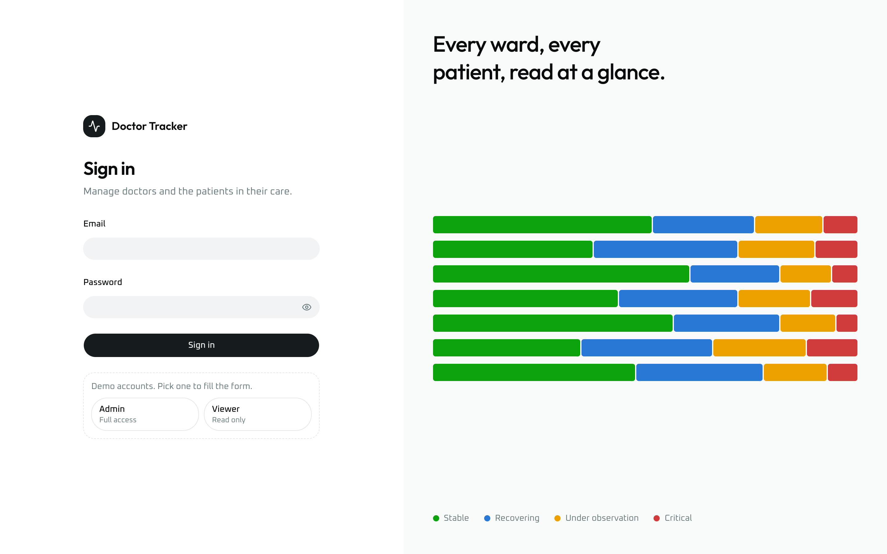 |

### Mobile

| Dashboard | Doctors | Patients | Navigation |
| --- | --- | --- | --- |
| 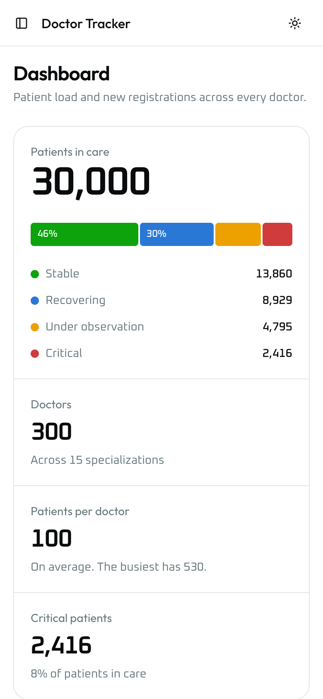 | 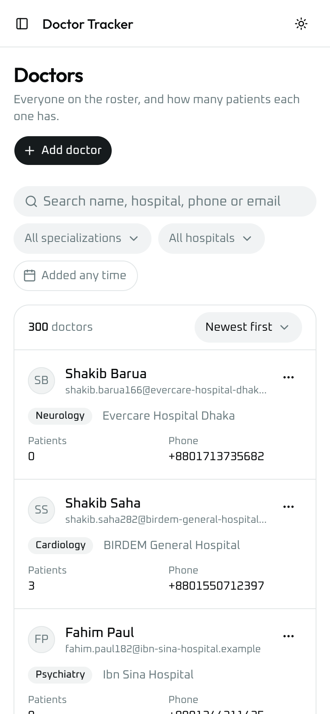 | 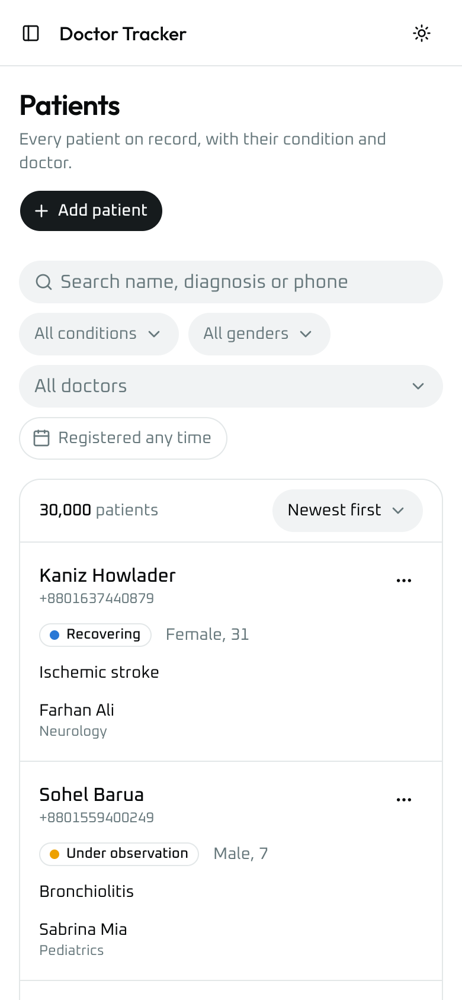 | 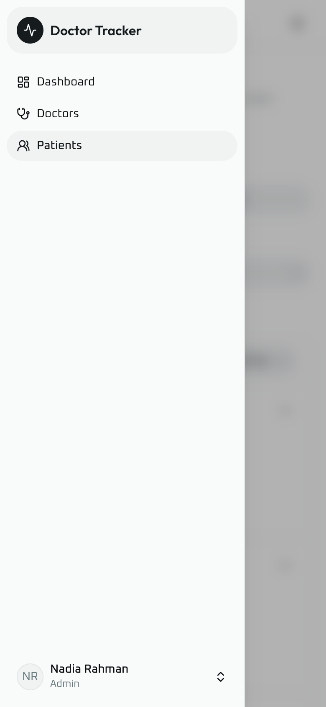 |
